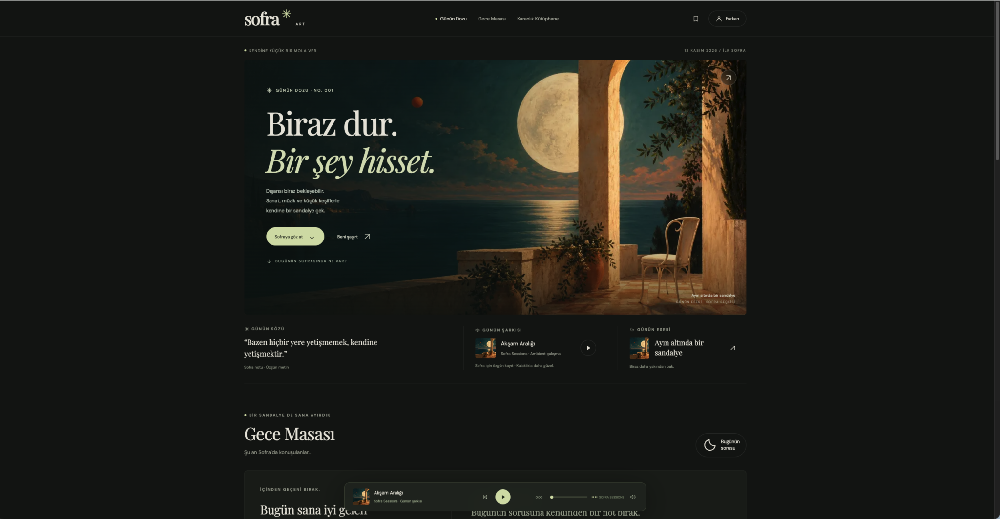
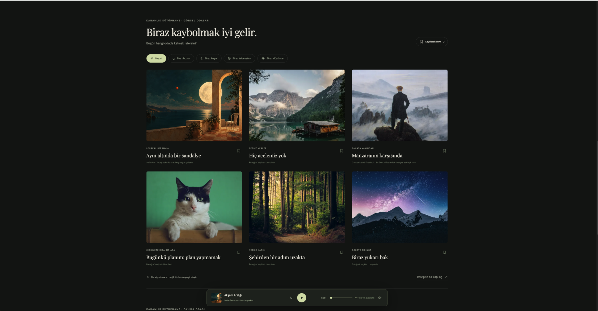
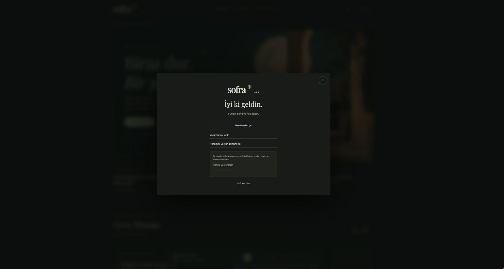
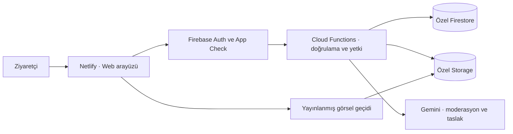
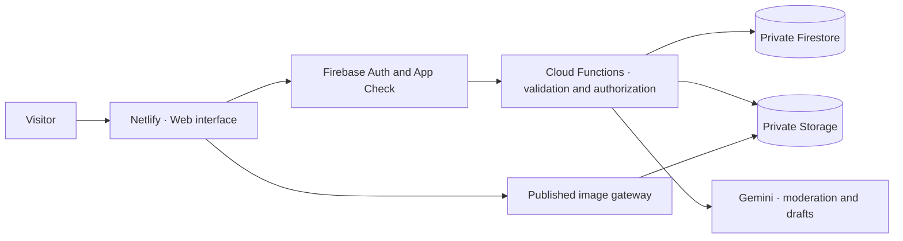

<div align="center">

# Sofra Art

**Sanat. Müzik. Biraz da kendin.**

Günün eserini, bir soruyu ve bir şarkıyı buluşturan sakin bir dijital alan.

[**Sofra’ya uğra ↗**](https://sofra-art.netlify.app) · [**Pinterest ↗**](https://tr.pinterest.com/sofravibes/) · [English](#english)

[](https://github.com/Furkanfidanogl/sofra-art/actions/workflows/quality.yml)

</div>



## Türkçe

Sofra Art, biraz durmak isteyenler için tasarlandı. Görsel odalarda ruh hâline göre gezinebilir, günün sorusuna bir not bırakabilir, kısa okumalar keşfedebilir veya müzik eşliğinde kendine zaman ayırabilirsin.

Ziyaretçi deneyiminin arkasında, içeriklerin taslak olarak hazırlandığı ve editör kararıyla yayımlandığı bir yönetim masası bulunur. Arayüz Türkçedir.

- **Günün sofrası:** eser, söz, soru ve müzik; Türkiye saatine göre tarihli yayın planlama.
- **Görsel odalar:** ruh hâli filtreleri, keşif testi, rastgele eser ve cihazda saklanan ayraçlar.
- **Kesintisiz gezinme:** sayfada kalıcı müzik oynatıcısı ve açık tercihle yüklenen tek şarkılık Spotify bağlantıları.
- **Özenli sohbet:** Google ile giriş, takma ad ve yorumu birlikte değerlendiren moderasyon, tekrar ve hız kontrolleri.
- **Editoryal yönetim:** özel görsel yükleme, önizleme, eser yayını ve yöneticiye yardımcı AI taslakları. Öneriler kendiliğinden yayımlanmaz.
- **Veri kontrolü:** yorumlarını indirme, Google ile yeniden kimlik doğrulaması sonrası hesabını/yorumlarını silme.

### Görsel odalar



### Hesabım



## Teknoloji altyapısı · Tech stack

| Katman / Layer | Teknoloji / Technology |
| --- | --- |
| Arayüz / Interface | JavaScript ES modules, Vite, CSS, native HTML dialogs |
| Kimlik / Identity | Firebase Authentication, Google sign-in, App Check, reCAPTCHA Enterprise |
| Sunucu / Server | Node.js 22, Firebase Cloud Functions v2 |
| Veri / Data | Cloud Firestore, transactions, indexes, private Cloud Storage |
| Yapay zekâ / AI | Google Gemini **`gemini-3.5-flash-lite`** |
| Yayın / Delivery | Netlify, responsive WebP images, self-hosted WOFF2 fonts |
| Kalite / Quality | Node.js test runner, Firebase Emulator Suite, GitHub Actions, dependency audits, publication and asset checks |

## Mimari



İlk ekran, yalnızca herkese açık varsayılan içerikle derleme sırasında hazırlanır; tarayıcı güncel günlük içeriği sunucudan alır. Firebase modülleri ihtiyaç duyulduğunda yüklenir. Görsellerin farklı ekran boyutlarına uygun sürümleri kullanılır, müzik kullanıcı başlatmadan çalmaz.

Tarayıcı Firestore veya Storage’a doğrudan erişmez. Sunucu, App Check’i ve işlem için gereken kimliği/yetkiyi doğrular. Yönetici yüklemeleri **20 MiB** ile sınırlıdır; gerçek dosya türü, piksel ve boyut kontrollerinden sonra WebP olarak yeniden kodlanır. Yalnızca yayındaki esere bağlı temizlenmiş görsel, ayrı bir geçitten sunulur.

Yorum, takma ad ve ilgili soru kelime listesi yerine bağlamıyla değerlendirilir: `true` onay, `false` ret, `unclear` yönetici incelemesi anlamına gelir. İlk ret kararı ikinci bir model değerlendirmesiyle doğrulanır; iki değerlendirme uyuşmazsa yorum otomatik yayımlanmaz ve yöneticiye kalır. Geçersiz model yanıtı, kota veya servis hatası da inceleme kuyruğuna düşer. Kısa tepkiler, emoji, gündelik dil ve saygılı olumsuz eleştiri desteklenir; moderasyon kusursuzluk garantisi taşımaz.

Tekrar gönderimler transaction ve istek kimliğiyle aynı yoruma bağlanır; sürüm denetimleri eşzamanlı editörlerin birbirinin değişikliğini ezmesini engeller. Editoryal AI yanıtları da isteği başlatan hesaba ve açık forma bağlıdır; hesap, sekme veya tarih değişirse eski öneri uygulanmaz.

**Veri akışı:** otomatik değerlendirme için takma ad, yorum ve ilgili soru Gemini’ye gönderilebilir. Hesap e-postası ve UID bu model isteğine eklenmez; yorum metnine yazılan kişisel bilgiler yine metinle birlikte iletilebilir. Onaylanan takma ad ve yorum herkese görünür. Ayrıntılar: [Gizlilik ve verilerin](https://sofra-art.netlify.app/gizlilik/).

## English

**Art. Music. A little room for yourself.**

Sofra Art is a quiet place for daily discoveries. Explore visual rooms, follow your mood, respond to a thoughtful question, read something short, or let the music accompany your visit.

The public experience is backed by an editorial workspace. Content starts privately as a draft and becomes visible through an explicit publishing decision. The interface is in Turkish; the shared technology stack is listed above.

- **A daily table:** an artwork, reflection, question and song, with publication scheduled in the Istanbul time zone.
- **Unhurried discovery:** mood filters, a short discovery quiz, random artwork and device-local bookmarks.
- **Music while you browse:** a persistent player and optional, consent-based Spotify embeds restricted to individual tracks.
- **Thoughtful conversation:** Google sign-in, nickname-aware moderation, duplicate detection and rate controls.
- **Editorial tools:** private image uploads, previews, artwork publishing and AI writing suggestions that remain drafts until reviewed.
- **Personal data controls:** comment export and account/comment deletion following recent Google authentication.

## Architecture



The build renders the initial screen from public defaults; the browser then loads the current daily content. Firebase modules load on demand, responsive image variants reduce transfer size, and audio starts only after user interaction.

The browser has no direct database or storage access. Functions enforce App Check, verified identities and operation-specific authorization. Administrator uploads are capped at **20 MiB**, checked for file signature and image dimensions, and re-encoded to WebP. A separate gateway exposes only sanitized images attached to currently published artwork.

Moderation evaluates the nickname, comment and related question in context rather than using a word blacklist. The exact string decisions are `true` for approval, `false` for rejection and `unclear` for human review. An initial rejection requires a second model assessment; disagreement stays unpublished for human review. Invalid output, provider failures and exhausted quotas also enter the review queue. Respectful criticism, everyday language, short reactions and emoji are supported; automated moderation cannot guarantee perfect decisions.

Transactions and request IDs make comment retries idempotent, while version checks prevent concurrent editors from overwriting each other. Editorial AI responses are bound to the initiating account and form context; changing the account, tab or date invalidates a stale suggestion.

**Data flow:** a nickname, comment and related question may be sent to Gemini for moderation. The account email and UID are not added to that request; personal information written inside the comment can still travel with its text. Approved nicknames and comments become public. See [Privacy and your data](https://sofra-art.netlify.app/gizlilik/) (Turkish).

## Kod haritası · Code map

| Dizin / Directory | Sorumluluk / Responsibility |
| --- | --- |
| [`src/`](src/) | Arayüz, oturum ve form durumu / UI, session and form state |
| [`functions/`](functions/) | Yetki, içerik, moderasyon, görsel ve veri işlemleri / Authorization, content, moderation, uploads and privacy operations |
| [`checks/`](checks/) · [`integration/`](integration/) | İzole kontroller ve emülatör senaryoları / Isolated checks and emulator scenarios |
| [`scripts/`](scripts/) | Build, yayın doğrulaması ve operatör araçları / Build, release validation and operator tools |
| [`public/`](public/) | Statik görseller, ses, fontlar ve bilgi sayfaları / Static media, fonts and information pages |
| [`docs/`](docs/) | Kurulum, yayın kabulü ve içerik kaynakları / Setup, release acceptance and asset credits |

## Yerelde çalıştır · Run locally

Use the Node version in [`.nvmrc`](.nvmrc). / [`.nvmrc`](.nvmrc) içindeki Node sürümünü kullan.

```sh
git clone https://github.com/Furkanfidanogl/sofra-art.git
cd sofra-art
npm ci
npm --prefix functions ci
cp .env.example .env.local
npm run dev
```

`VITE_SOFRA_BACKEND_ENABLED=false` starts a device-local demo. Production credentials are unnecessary for development or CI. / Bu ayar cihaz içi demoyu açar; geliştirme ve CI için üretim kimlik bilgileri gerekmez.

```sh
npm run check
npm run check:emulators
npm run build
node scripts/check-assets.cjs
node scripts/check-secrets.cjs --history
```

Emulator tests use the isolated `demo-sofra` project and require Java 21. / Emülatör testleri izole `demo-sofra` projesini kullanır ve Java 21 gerektirir.

### Test stratejisi · Testing strategy

| Katman / Layer | Doğrulanan davranış / Verified behavior |
| --- | --- |
| Birim ve arayüz kontrolleri / Unit and UI checks | Doğrulama, kaçışlama, model şeması, oturum değişimi ve eski AI yanıtları / Validation, escaping, model schemas, account changes and stale AI responses |
| Emülatör entegrasyonu / Emulator integration | Gerçek servis koduyla erişim reddi, taslak gizliliği, yayın planı ve eşzamanlı tekrarlar / Access denial, draft privacy, scheduling and concurrent retries through the real service code |
| Yayın kapısı / Publication gate | İzinli dosyalar, belge bağlantıları, sır desenleri, bağımlılıklar ve asset bütçesi / Allowed files, documentation links, secret patterns, dependencies and asset budgets |

Testler model yanıtlarını kontrollü olarak taklit eder; emülatör paketi üretim projesine bağlanmayı reddeder. Canlı model değerlendirmesi, gerçek Google oturumu ve cihaz kabulü ayrı kontrollerdir. / Tests use controlled model responses; the emulator suite refuses a production project. Live model evaluation, real Google sessions and device acceptance are separate checks.

## Proje belgeleri · Project documentation

[Kurulum ve operasyon / Setup and operations](docs/OPERATIONS.md) · [Canlıya çıkış kontrolleri / Go-live checks](docs/PRODUCTION_GO_LIVE.md) · [Güvenlik / Security](SECURITY.md) · [İçerik kaynakları / Asset credits](docs/ASSETS.md)

Ekran görüntüleri mevcut ürün arayüzünü gösterir. Görsel, ses ve font dosyalarının kullanım koşulları kaynaklarına bağlıdır. / Screenshots show the product interface. Artwork, audio and fonts retain their respective attribution and usage conditions.
